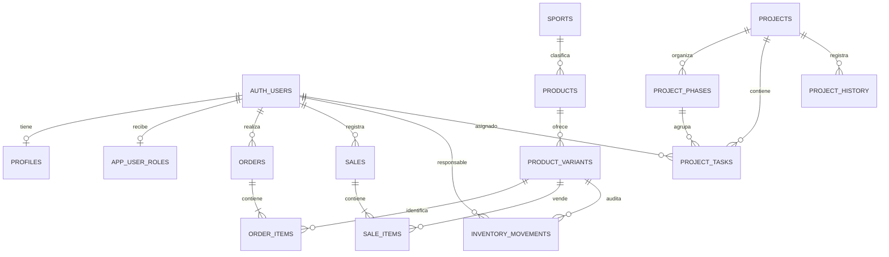

# Modelo de datos observado y propuesto

El esquema legado se infiere únicamente de las consultas del repositorio. Las tablas nuevas describen las migraciones preparadas en `database/migrations/`; no se afirma que estén aplicadas.

`profiles`, `sports`, `products`, `product_variants`, `orders` y `order_items` existen como nombres en consultas legadas. `app_user_roles`, `sales`, `sale_items`, `inventory_movements`, `projects`, `project_phases`, `project_tasks` y `project_history` son definiciones propuestas en migraciones revisables. Verificar las relaciones existentes y tipos de ID antes de aplicar.
